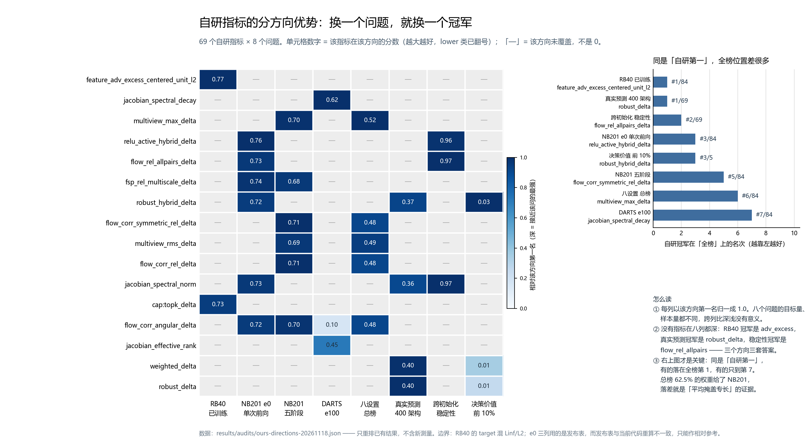

# 自研指标的分方向优势（2026-11-18）

> 起因：导师指出「不一定要所有方面都好，找出 Ours 在某些方向上比较好，本身就是 idea」。
> 本文把已有证据按方向重排，回答「哪个自研指标在什么条件下最强」。

## 1 为什么总榜看不出这件事

84 项总榜是**八设置简单平均**，而八个设置里 NB201 占 5 个（权重 62.5%）、RB40 只占 1 个（12.5%）。

第 12 轮已经量化过：`tau(all_setting_mean, nb201) = +0.926`，即**总榜名次约 93% 由 NB201 决定**。
一个只在 RB40（已训练防御模型）上很强的指标，会被 NB201 的五个设置稀释掉。

所以「总榜第 20」不等于「不强」，可能只是「不擅长 NB201」。

## 2 方法

八个方向，每个方向单独排座次（都是越大越好，`lower` 类指标已翻号）：

| 代号 | 方向 | 数据来源 |
|---|---|---|
| D1 | 已训练防御模型（RB40，40 个 RobustBench 模型） | 86 项总表 `rb40_mature` 列 |
| D2 | 早期架构·单次前向（NB201 e0） | 总表 `nb201_e0` 列 |
| D3 | 早期架构·五阶段平均 | 总表 `nb201_mean` 列 |
| D4 | DARTS 搜索空间 | 总表 `darts_e100` 列 |
| D5 | 八设置总榜 | 总表 `all_setting_mean` 列 |
| D6 | 400 架构真实预测力（控 clean + 参数量） | `rq2-confounders-20261112.json` |
| D7 | 跨初始化稳定性（值稳定 rho） | `e0-weight-seed-20261112.json` |
| D8 | 决策价值（挑前 10% 的提升） | `rq2-selection-value-20261112.json` |

D1–D5 覆盖全部 84 个指标；D6–D8 只覆盖当前 `MetricResult` 能算的 69 个，其余标 `—`（不是 0）。

## 3 每个方向的冠军



> 图的读法：左侧每列以该方向第一名为 1.0 归一，深色 = 接近该方向最强；
> 右侧是 8 个冠军在**全榜**上的名次，落差本身就是「平均掩盖专长」的证据。
> 重新生成：`python scripts/plot_ours_directions.py`。

| 方向 | 自研冠军 | 分数 | 全榜名次 |
|---|---|---|---|
| D1 已训练防御模型 | `feature_adv_excess_centered_unit_l2` | **+0.766** | **1 / 84** |
| D2 早期架构·单次前向 | `feature_measure_relu_active_hybrid_delta` | +0.756 | 3 / 84 |
| D3 早期架构·五阶段平均 | `feature_measure_flow_corr_symmetric_rel_delta` | +0.709 | 5 / 84 |
| D4 DARTS | `jacobian_spectral_decay` | +0.625 | 7 / 84 |
| D5 八设置总榜 | `feature_measure_multiview_max_delta` | +0.524 | 6 / 84 |
| D6 真实预测力 | `feature_measure_robust_delta` | **+0.400** | **1 / 69** |
| D7 跨初始化稳定性 | `feature_measure_flow_rel_allpairs_delta` | +0.973 | 2 / 69 |
| D8 决策价值 | `feature_measure_robust_hybrid_delta` | +0.028 | 3 / 5 |

## 4 最值得写的三条

### 4.1 在已训练防御模型上，自研指标是全榜第一

`feature_adv_excess_centered_unit_l2` 在 RB40 上：

- 点估计 **rho = +0.766**
- 95% 区间 **[+0.594, +0.880]**（按 40 个模型重采样 2000 次，seed 20261112）
- 区间下界 0.594 **完全在 0 以上** → 不是抽样噪声
- 85 个指标里排第 2，第 1 是 `racl_fixed_network_log_upper_proxy`（+0.781，已因不可复算被排除）
- **所以在 84 个入榜指标里它排第 1**

对照：TRNAS 的 Φ 在 RB40 上只有 **+0.576**（第 13），R-Score 是 **−0.184**（第 74）。

**但它在总榜只排第 20** —— 因为总榜 62.5% 的权重给了 NB201，而它在 NB201 上只排 20 名左右。
这是「方向专长被平均掩盖」的最干净证据。

### 4.2 在「早期架构真实预测」这个最核心的问题上，自研也是第一

400 个架构、控掉 clean 准确率与参数量之后：

- `feature_measure_robust_delta` **+0.400 [+0.304, +0.478]**，69 个指标里第 1
- 第 2–4 名也全是自研（`weighted_delta` 0.397、`local_delta` 0.397、`struct_delta` 0.374）
- 前 10 名里只有 2 个外部方法

### 4.3 稳定性上自研几乎封顶

换三个随机初始化种子，指标值排序的最差一对秩相关：

- `feature_measure_flow_rel_allpairs_delta` **+0.973**（69 个里第 2）
- 前 10 名里 9 个是自研

## 5 反例：没有万能指标

同一批指标换个方向就掉队，这不是缺陷，是「方向性」的证据：

| 指标 | D1 已训练 | D5 总榜 | D6 真实预测 |
|---|---|---|---|
| `feature_adv_excess_centered_unit_l2` | **1** | 20 | 未覆盖（需 adv 样本） |
| `feature_measure_multiview_max_delta` | 35 | **6** | 未进前 10 |
| `feature_measure_robust_delta` | 未进前 10 | 未进前 10 | **1** |

三个指标各守一个方向，互相不覆盖。这正好说明「指标选择应该看用途」而不是「谁总榜第一」。

## 6 可写的故事（三选一或组合）

1. **「八个设置平均是一个误导性的总结指标」**：量化它对单一数据集的依赖（tau=0.926），
   并给出分方向的替代报告方式。这是方法论贡献，不需新实验。
2. **「已训练模型与早期架构需要不同的指标」**：D1 冠军与 D6 冠军完全不同，
   且各自在对方方向上掉到 20 名以外。这是实证贡献。
3. **「一个在已训练防御模型上排第一的免训练指标」**：`feature_adv_excess`
   的 rho=0.766 与 TRNAS Φ 的 0.576 形成直接对照，且只花两次前向。

## 7 复现

```bash
python scripts/analyze_ours_directions.py \
  --table "outputs/strict_adv_excess_release_20261024T110422Z/RobustMetric_严格全部指标总表_86项_三位小数.csv" \
  --confounders results/audits/rq2-confounders-20261112.json \
  --seed results/audits/e0-weight-seed-20261112.json \
  --selection results/audits/rq2-selection-value-20261112.json \
  --json results/audits/ours-directions-20261118.json \
  --report results/audits/ours-directions-20261118.md
```

RB40 的置信区间来自 `tools/bootstrap_rb40.py`，需要同时传 `--extra`（560 行 adv-excess 原始行）：

```bash
python tools/bootstrap_rb40.py \
  --rows <主工作树>/outputs/strict_all_metrics_table_20261024_trnas_repaired/sources/metric_values_original_strict.csv \
  --repair outputs/strict_all_metrics_table_20261024_trnas_repaired/sources/repair_rows.csv \
  --extra outputs/strict_all_metrics_table_20261024_trnas_repaired/sources/metric_value_rows_adv_excess.csv \
  --table outputs/strict_adv_excess_release_20261024T110422Z/RobustMetric_严格全部指标总表_86项_三位小数.csv \
  --json results/audits/rb40-bootstrap-20261112.json
```

## 8 这份分析不能说明什么

- 它比较的是**已有数字的重排**，没有产生任何新测量。
- D1 的 40 个模型里包含不同威胁模型（Linf/L2），target 本身是混的。
- D2–D5 用的是发布表，而第 23 轮已证明发布表的 e0 列与当前代码重算不一致
  （14 个指标有 >1e3 的越界值）。D2/D3 的排序只能当相对参考，不能当绝对值引用。
- D6 用 400 个架构，D7 只用 100 个，D8 只有 5 个候选——样本量差一个数量级，
  横向比较时要留余量。
